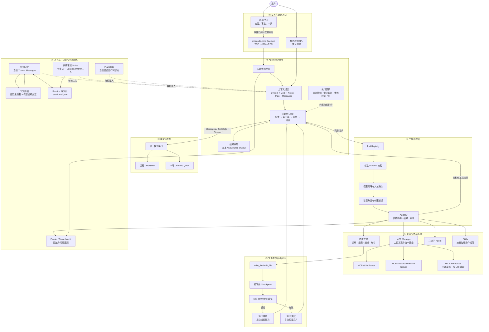

# minicode 架构图

minicode 是一个支持远程 DeepSeek 和本地 Ollama/Qwen 的轻量级 Agent Runtime。它通过统一的 Agent Loop 调度内置工具、MCP、Skills 和只读子 Agent，并在工具执行外围提供参数校验、权限审批、审计、错误恢复、checkpoint 与 verification。



## 一次任务的执行路径

```text
用户目标
→ 组装当前上下文与可用工具
→ 模型决定回答或调用工具
→ Registry 校验参数和权限
→ 执行内置工具、MCP、Skill 或子 Agent
→ 工具结果携带审计信息返回 Agent Loop
→ 修改类任务创建 checkpoint 并运行 verification
→ 验证成功后提交批次，失败则回滚文件并调整方案
→ 输出文本或结构化结果
→ 保存 Session、Events、Trace 和 Audit
```

## 面试介绍

> minicode 不是简单的聊天机器人，而是一个轻量级 Agent Runtime。上层支持单进程和 daemon/client 两种运行方式，中间通过统一 Agent Loop 调度远程 DeepSeek 或本地 Qwen，下层通过 Tool Registry 管理内置工具、MCP、Skills 和子 Agent，并在工具执行外围实现参数校验、权限审批、审计、错误恢复，以及 checkpoint 和 verification 安全闭环。

## 边界说明

- MCP Resource 不会自动进入上下文，必须先发现再按 URI 主动读取。
- Notes 是当前 Session 的持久笔记，不是跨所有 Session 的全局知识库。
- PlanState 是运行时任务状态，当前不会随 Session 持久化。
- checkpoint 只覆盖内置文件写入；命令、MCP 和外部系统副作用不会自动回滚。
- Events、Trace 和 Audit 用于审计与回放，不会自动作为记忆注入模型。
